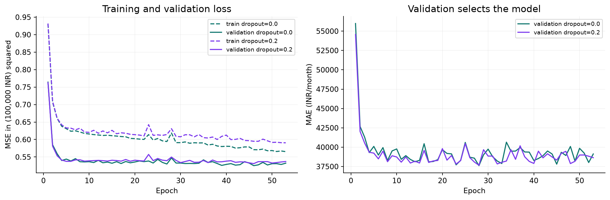
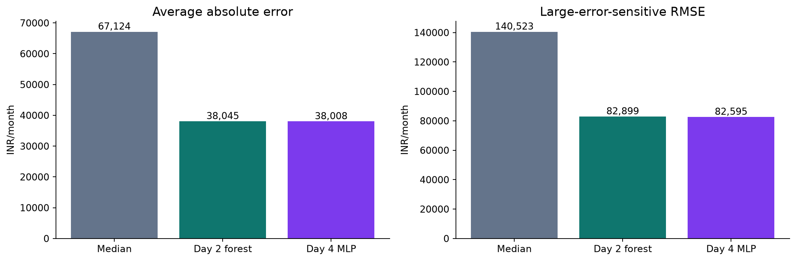
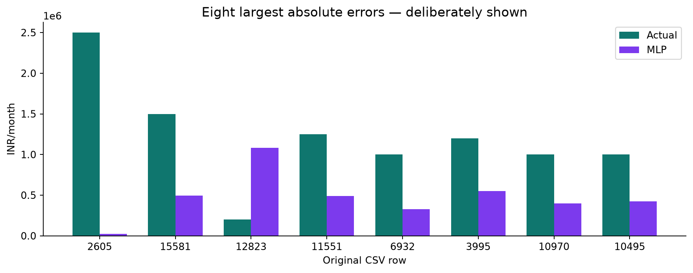
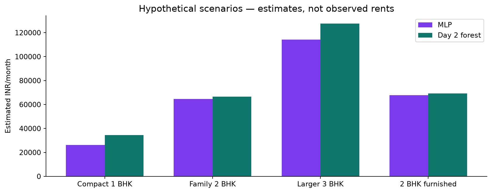

# Predicting Mumbai rent with a neural network

**Published Hugging Face model:** [Mumbai Rental Price Estimator](https://huggingface.co/iaac-maai/day4-group3-ai_methods_MumbaiRentals)

**Model card:** [View model documentation](models/README.md)

**Training notebook:** [neural_network.ipynb](notebook/neural_network.ipynb)

**Evaluation results:** [evaluation.json](reports/evaluation.json)

**AI Methods I · Day 4 · Track A1 · IAAC MaAI 2026/27**
**Group 3:** Ahmed Belahcen, Nandini Rathod, Sanjana Kiran and Akanksha Dhumal.

## What is the project about?

The project investigates whether a small neural network can predict monthly residential rental prices in Mumbai, India, using property listing characteristics. It builds on the Day 2 assignment, which used a Random Forest regression model, and compares both approaches on the same test data.

### Use case and intended users

The model is intended for educational research and exploratory housing market analysis. A housing researcher or analyst could use it to compare rental price estimates across different property characteristics and investigate how machine learning models respond to changes in listing attributes.

For example, the model could help explore rental budget scenarios by estimating the monthly advertised rent of a property based on its features.

### Cost of prediction errors

Prediction errors can have practical consequences:

- **Underestimating rent:** May lead to unrealistic housing budgets or incorrect expectations about affordability.
- **Overestimating rent:** May cause someone to reject a potentially affordable property.
- **Large prediction errors:** May be especially misleading for unusual or expensive properties.

The model is a coursework experiment rather than a professional property valuation system. Its predictions should not be used as the sole basis for financial commitments or rental decisions.

## Data

The cleaned Mumbai file has **18,846 rows and 26 columns**. Each row is an advertisement. The target is `Price_num`, in INR per month. The source is Harshal Honde's [Property Rental Listings Dataset](https://www.kaggle.com/datasets/harshalhonde/property-rental-listings-dataset); the group's earlier documentation declares CC BY 4.0. See [DATA_ATTRIBUTION.md](DATA_ATTRIBUTION.md) for the pinned source and checksum.

The notebook downloads the exact cleaned Day 2 CSV if it is missing, then verifies its checksum. Data and model weights are excluded from GitHub by `.gitignore`.

## How the experiment works

The project compares a PyTorch multilayer perceptron (MLP) with the Random Forest model developed during Day 2 and a simple median-rent baseline.

### Dataset and preprocessing

The experiment uses 18,846 cleaned Mumbai rental advertisements. The target variable is `Price_num`, representing advertised monthly rent in Indian Rupees (INR).
The original Day 2 train/test split is preserved for a fair comparison:
- **Training set:** 15,076 listings
- **Test set:** 3,770 listings
- **Random seed:** 42
The training set is further divided into 12,060 fitting samples and 3,016 validation samples for model selection.
Numeric features are imputed and standardized, while categorical features are imputed and one-hot encoded. During tuning, preprocessing is fitted only on the fitting subset to prevent information leakage.

### Neural network architecture
The final model is a fully connected neural network implemented in PyTorch.

**Architecture:** 23 input features → 64 hidden neurons → 32 hidden neurons → 1 output.
- **Activation:** ReLU
- **Trainable parameters:** 3,649
- **Optimizer:** Adam
- **Learning rate:** 0.001
- **Batch size:** 256
- **Loss function:** Mean Squared Error (MSE), with rent divided by 100,000 during training
- **Final dropout:** 0
- **Selected training epochs:** 28
- **Hardware:** CPU, using two PyTorch threads

The final output represents the estimated monthly rental price after reversing the target scaling.

### Experiments and model selection
Two dropout configurations were compared:
1. **Dropout 0:** No dropout regularization.
2. **Dropout 0.2:** Dropout regularization to reduce potential overfitting.

Both configurations used the same architecture, optimizer, learning rate and batch size.
Model selection was based on the lowest validation Mean Absolute Error (MAE). The experiment selected the configuration without dropout and 28 training epochs.
A fresh model was then trained on all 15,076 outer-training listings using the selected configuration.
During tuning, the preprocessor produced 22 encoded inputs. Refitting on the larger training set introduced one additional category, resulting in 23 inputs for the final saved model.

### Baseline comparison
The final neural network was evaluated against two baselines using the same held-out test set:

| Model | MAE (INR/month) | RMSE (INR/month) | R² |
|---|---:|---:|---:|
| Median baseline | 67,123.75 | 140,522.95 | -0.0955 |
| Day 2 Random Forest | 38,044.93 | 82,899.45 | 0.6187 |
| Day 4 MLP | 38,008.45 | 82,594.83 | 0.6215 |

The MLP reduced MAE by approximately 43.4% compared with the median baseline. However, its improvement over the Random Forest was only approximately 36 INR/month, or 0.1%.
These results suggest that the MLP and Random Forest achieve very similar predictive performance on this dataset. The small difference does not establish a meaningful advantage for the more complex neural network.
Training timings and library versions are recorded in `reports/evaluation.json`.

## Results

| Model | MAE (INR/month) | RMSE (INR/month) | R² |
|---|---:|---:|---:|
| Median baseline | 67,123.75 | 140,522.95 | -0.0955 |
| Day 2 Random Forest | 38,044.93 | 82,899.45 | 0.6187 |
| Day 4 MLP | 38,008.45 | 82,594.83 | 0.6215 |

The MLP reduces MAE by about 43.4% compared with the median baseline. It improves on the forest by only about 36 INR/month, or 0.1%. The fair conclusion is that the two models perform similarly on this test set.



Most of the improvement happens in the first few epochs. Validation MAE selects epoch 28 without dropout; continuing training does not give a steady improvement.



Both learned models improve on the median baseline. The MLP and Random Forest are almost tied, so the small difference is not enough to claim a meaningful advantage.



These are the eight largest errors. Their rent and area combinations deserve source checking, but they remain in the evaluation rather than being removed to improve the score.



The examples show how estimates change between four handmade property descriptions. They have no observed rent, so this is an application example rather than another accuracy test.

## Run the project

Use Python 3.12. From the project directory on Windows:

```powershell
python -m venv .venv
.\.venv\Scripts\python.exe -m pip install -r requirements.txt
.\.venv\Scripts\python.exe run_notebook.py
```

You can also open the notebook in Jupyter or VS Code, select this environment and use **Restart Kernel → Run All**. The notebook accepts either the project root or `notebook/` as its working directory.

`TRAIN=True` runs the full experiment. `TRAIN=False` loads the final neural network, uses the recorded histories and refits the inexpensive Day 2 comparators. It does not need intermediate neural-network checkpoints. `publication.json` pins the existing Hugging Face model to revision `1b628c61c956fdd97543c1f21e258d023a041109`. Missing model files download automatically from that revision. Retraining only writes local files; it never uploads or overwrites the published model.

For a prediction/reload check, run `python predict_local.py`. `python execute_local.py --train` executes the notebook cells sequentially without Jupyter's kernel transport, capturing their real outputs. Use `python run_notebook.py --train` for a fresh Jupyter-kernel training run, or `python run_notebook.py --no-train` to load the published model. `python verify_project.py --remote` checks fresh downloads and predictions.

## Files

| Path | Purpose |
|---|---|
| `data/` | Exact cleaned CSV, downloaded if absent; excluded from GitHub |
| `notebook/` | Documented notebook and execution outputs |
| `figures/` | Seven exported plots |
| `models/` | Weights, preprocessing, configuration, model card and its figures |
| `reports/` | Histories, metrics, scenarios and inspection outputs |
| `source_reference/` | Day 2 evidence used to reproduce the comparator |
| `project_io.py` | Data checksum and missing-file downloads |
| `predict_local.py` | Load the saved model and predict |
| `publication.json` | Published repository and pinned revision |
| `requirements.txt` | Pinned packages |
| `LICENSE` | MIT license for project code and model |

## Limitations

These are historical advertisements, not verified rental transactions. The collection date is unknown, `Location` does not include neighborhoods, some area units may be inconsistent, and many balcony values are missing. There are 752 test rows with an exact feature-and-target match in training. We report this because the random split can make generalization look better than it is. Excluding those exact matches gives an MLP MAE of about 41,619 INR/month, but that check cannot identify every repeated dwelling. The model is not validated for current valuations, other cities, eligibility decisions or financial commitments.

## AI usage
### Tools
ChatGPT and Codex were used as AI-assisted tools during the development of this assignment.

### Why
We used AI tools to support the implementation, debugging, visualization and documentation of our neural network experiment. These tools helped us organize the workflow, understand implementation details and communicate the results more clearly.

### Where
AI assistance was used in the following areas:
- **Code development:** Supporting the implementation and debugging of the PyTorch neural network and associated Python scripts.
- **Data processing:** Assisting with the structure of preprocessing and evaluation workflows.
- **Visualizations:** Supporting the generation and presentation of training curves, model comparisons and prediction-error figures.
- **Documentation:** Helping organize the README, explain the methodology and present the evaluation results.

### How
The repository documents several verification procedures used to check the project:
- Checking the dataset checksum to ensure the correct data version was used.
- Preserving the Day 2 train/test split and Random Forest configuration for a fair comparison.
- Executing the notebook to verify that the workflow runs.
- Testing predictions using the saved model and preprocessing artifacts.
- Comparing the MLP against the Random Forest and median baselines using the same test set.

AI-assisted explanations and code should be checked against the actual notebook outputs, evaluation metrics and saved model artifacts. Any incorrect descriptions or unsupported claims must be corrected before final submission.

### Lessons learned
This assignment demonstrated that AI tools can help accelerate coding, debugging and technical documentation, but their outputs require careful verification. We learned the importance of checking model architecture, preprocessing, evaluation metrics and experimental results against the actual implementation rather than relying only on AI-generated explanations. The comparison between the MLP and Random Forest also reinforced the importance of interpreting results critically. Although the neural network achieved a slightly lower MAE, the difference was small and did not justify claiming a substantial improvement. Overall, AI tools were used as development aids, while reproducibility, verification and interpretation remained essential parts of the project.

## License and hand-in

Code and model: MIT. Data: separately attributed under its declared CC BY 4.0 license. 
