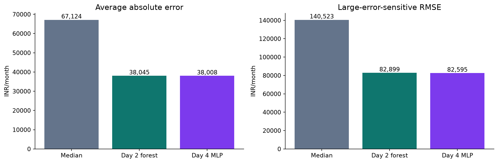
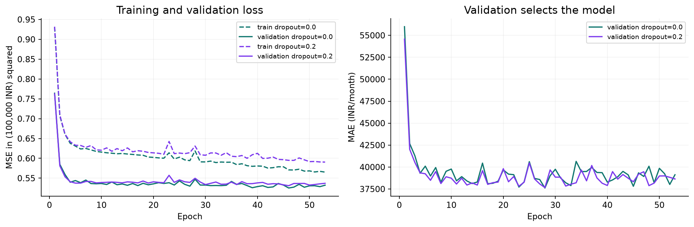
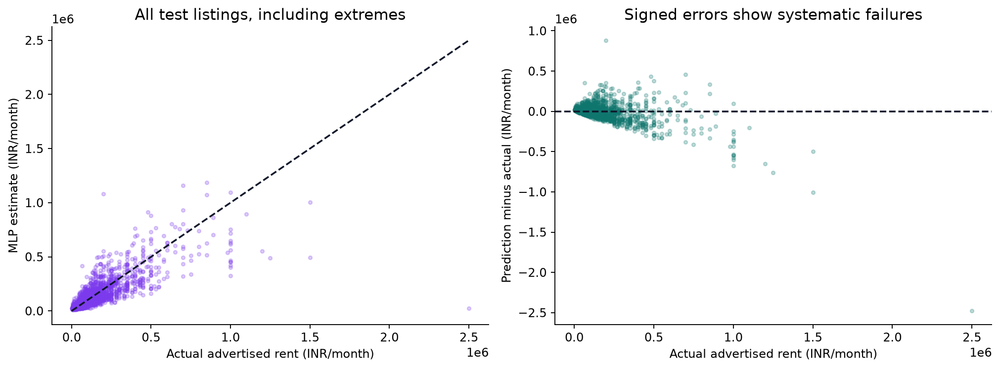
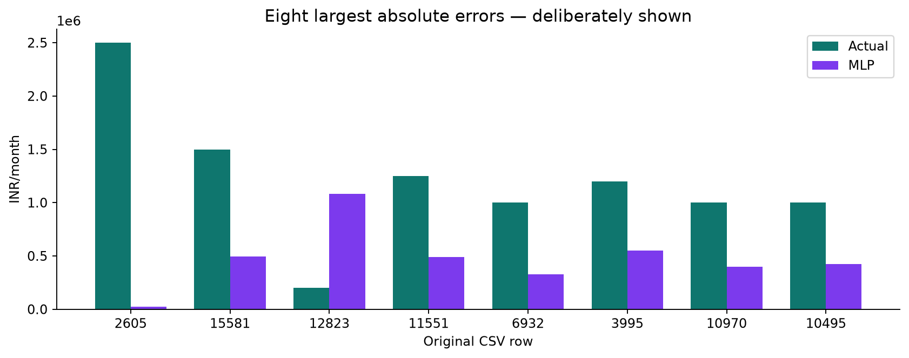
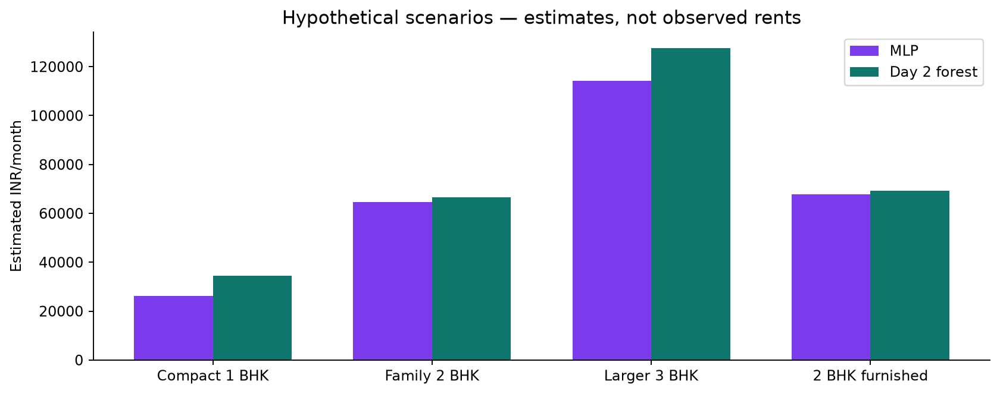

# Mumbai rental MLP

This model estimates monthly advertised Mumbai rent from eight property features. It was trained from scratch for AI Methods I, Day 4, Track A1 at IAAC. The aim is to compare a neural network with the group's Day 2 Random Forest on the same problem.

**Authors:** Ahmed Belahcen, Nandini Rathod, Sanjana Kiran and Akanksha Dhumal.
**Source:** https://github.com/iaac-maai/group-3-day4-assignment
**Published model:** https://huggingface.co/iaac-maai/day4-group3-ai_methods_MumbaiRentals
**Pinned revision:** `1b628c61c956fdd97543c1f21e258d023a041109`.

## Model at a glance

| Model | MAE (INR/month) | RMSE (INR/month) | R² |
|---|---:|---:|---:|
| Median baseline | 67,123.75 | 140,522.95 | -0.0955 |
| Day 2 Random Forest | 38,044.93 | 82,899.45 | 0.6187 |
| Day 4 MLP | 38,008.45 | 82,594.83 | 0.6215 |



Both learned models improve on the median baseline. The MLP and Random Forest are almost tied, so the small difference is not enough to claim a meaningful advantage.



Most of the improvement happens in the first few epochs. Validation MAE selects epoch 28 without dropout; continuing training does not give a steady improvement.



The plot includes the full test range. Several expensive advertisements are underestimated, while some unusually large properties are overestimated.



These are the eight largest errors. Their rent and area combinations deserve source checking, but they remain in the evaluation rather than being removed to improve the score.



The examples show how estimates change between four handmade property descriptions. They have no observed rent, so this is an application example rather than another accuracy test.

## Intended use

A housing researcher can compare preliminary property-budget scenarios. Both overestimates and underestimates can mislead planning, so MAE and RMSE are reported together. The small difference from the forest is not enough to establish a practical improvement. The model is not validated for current rental valuations, other cities, housing eligibility, lending or decisions about individuals.

## Model details

| Item | Value |
|---|---|
| Task | Regression; monthly advertised rent in INR |
| Architecture | 23 → 64 → 32 → 1; ReLU; dropout 0 |
| Parameters | 3,649, all trainable |
| Pretrained model | None |
| Output conversion | Multiply by 100,000 and clip at zero |
| Required files | `model.pt`, `scaler.joblib`, `config.json` |
| Python | 3.12.14 |
| PyTorch | 2.14.1+cpu |
| scikit-learn | 1.9.1 |
| NumPy / pandas / joblib | 2.5.4 / 3.1.0 / 1.6.0 |

## Inputs

| Column | Meaning and unit | Preparation |
|---|---|---|
| Area_num | Reported area in ft²; unit consistency unverified | Median imputation, standardization |
| BHK_num | Bedroom count | Median imputation, standardization |
| Bathrooms_num | Bathroom count | Median imputation, standardization |
| Balconies_num | Balcony count | Median imputation, standardization |
| Furnished_clean | Furnishing category | Mode imputation, one-hot encoding |
| Facing | Orientation | Mode imputation, one-hot encoding |
| Location | City; constant Mumbai | Mode imputation, one-hot encoding |
| Property Type | Property category | Mode imputation, one-hot encoding |

All preparation is fitted on training rows. `config.json` gives the exact column order. `scaler.joblib` contains the full preprocessing pipeline, not just a numeric scaler. This is regression, so the output is not a class probability.

## Data and training

Source: Harshal Honde's [Property Rental Listings Dataset](https://www.kaggle.com/datasets/harshalhonde/property-rental-listings-dataset), declared CC BY 4.0 in the group's earlier documentation. Group 3 cleaned the Mumbai subset into 18,846 rows. The unchanged Day 2 snapshot is identified by SHA-256 `354d28e07432137cdc97a2197a556269137e74135af01186420e2e2917a19ee9`.

The split is 15,076 outer-training and 3,770 test rows, seed 42. Model selection uses 12,060 fitting and 3,016 validation rows. The tuning encoder has 22 inputs; refitting on all training rows introduces one extra category and produces the final 23-input model.

Training uses Adam, learning rate 0.001, batches of 256 and MSE on rent/100,000. Dropout 0 and 0.2 are compared with the same other settings. The run stops after 25 epochs without a better validation MAE, with a maximum of 250 epochs. Validation selected no dropout and epoch 28. A fresh network is then trained on all outer-training rows for exactly 28 epochs. The test scores do not select the weights.

Hardware: CPU, two PyTorch threads. Measured timings are recorded in `../reports/evaluation.json`. The curves above show the selection runs.

## Evaluation and errors

The MLP has MAE about 38,008 INR/month and R² about 0.622. It beats the median baseline, but its MAE is only about 36 INR/month lower than the forest's. This is a similar result, not convincing evidence that the neural network is better.

The largest miss is a one-bedroom listing with reported area 655 ft² and rent INR 2,500,000/month. The model estimates about INR 21,867. Another listing reports 10,000 ft² and rent INR 200,000; the estimate is about INR 1,081,762. These combinations need source checking. Neither error is a reason to remove a test row after seeing the result.

## Limitations

These are historical advertisements, not verified rental transactions. The collection date is unknown, `Location` does not include neighborhoods, some area units may be inconsistent, and many balcony values are missing. There are 752 test rows with an exact feature-and-target match in training. We report this because the random split can make generalization look better than it is. Excluding those exact matches gives an MLP MAE of about 41,619 INR/month, but that check cannot identify every repeated dwelling. The model is not validated for current valuations, other cities, eligibility decisions or financial commitments.

## How to use

The code below downloads the three files from a fixed published revision, then reconstructs the exact network and preprocessing. Install the project requirements first.

```python
from pathlib import Path
import json, joblib, numpy as np, pandas as pd, torch
from torch import nn
from urllib.request import urlretrieve

folder = Path("models")
folder.mkdir(exist_ok=True)
repo = "iaac-maai/day4-group3-ai_methods_MumbaiRentals"
revision = "1b628c61c956fdd97543c1f21e258d023a041109"
for name in ("model.pt", "scaler.joblib", "config.json"):
    if not (folder / name).exists():
        urlretrieve(f"https://huggingface.co/{repo}/resolve/{revision}/{name}", folder / name)
config = json.loads((folder / "config.json").read_text())
model = nn.Sequential(
    nn.Linear(config["input_dim"], 64), nn.ReLU(), nn.Dropout(config["dropout"]),
    nn.Linear(64, 32), nn.ReLU(), nn.Dropout(config["dropout"]), nn.Linear(32, 1))
model.load_state_dict(torch.load(folder / "model.pt", map_location="cpu", weights_only=True))
model.eval()
preprocessor = joblib.load(folder / "scaler.joblib")
example = pd.DataFrame([[1000, 2, 2, 1, "Semi-Furnished", "East", "Mumbai", "Apartment"]],
                       columns=config["features"])
x = torch.tensor(preprocessor.transform(example), dtype=torch.float32)
with torch.no_grad():
    rent = np.maximum(model(x).numpy().ravel() * config["target_scale"], 0)
print(rent)  # INR per month
```

The project includes a separate-process reload check using four saved scenarios and an empty-directory download check: `python verify_project.py --remote`.

## Reproducibility, license and security

The GitHub project contains `notebook/neural_network.ipynb`, `requirements.txt`, the training histories and the pinned dataset source. Keep the PNG files beside this card so its figures render. The existing Hugging Face publication reports Python 3.12.10, PyTorch 2.15.0+cpu and pandas 3.0.6; the training environment uses Python 3.12.14, PyTorch 2.14.1+cpu and pandas 3.1.0. The published weights reproduce the recorded metrics in the training environment. Retraining may vary across versions; the two runs must not be presented as the same execution.

The code and model use MIT. The data keeps its separately declared CC BY 4.0 attribution. Joblib files can execute code when loaded: use trusted model files only. The example loads PyTorch weights with `weights_only=True`.

## AI assistance

ChatGPT/Codex assisted with code, figures and documentation. Verification included the dataset checksum, the Day 2 split and Random Forest settings, full notebook execution and saved-model predictions.